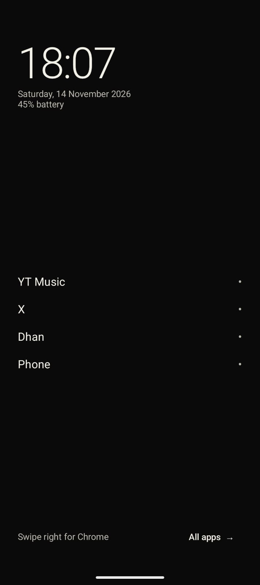
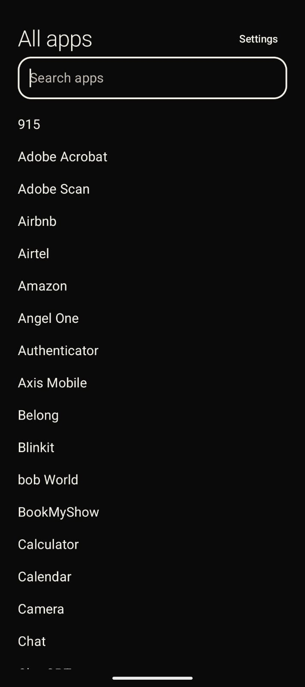
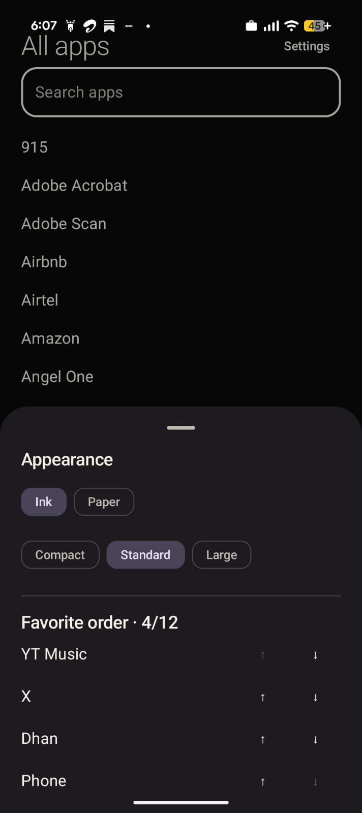

# Virama

Virama is a minimal, text-first Android home launcher built to reduce visual clutter. It keeps the home screen focused on the time, date, battery level, and a small list of favorite apps.

<p align="center">
  
  
  
</p>

## Features

- Minimal home screen with up to twelve favorite apps
- Searchable, alphabetical app list
- Swipe right to open Chrome and left to open All Apps
- Light and dark palettes with three text sizes
- Automatic updates when apps are installed, removed, enabled, or renamed
- Local settings with no internet access, analytics, or ads

## Built with

- Kotlin
- Jetpack Compose and Material 3
- Android DataStore
- ViewModel
- Unit and UI tests
- Reverse Engineer Anything (REA) skill for application analysis

## Install

Download the APK from the repository's **Releases** section. Virama currently requires Android 17 (API 37).

## Build

Install JDK 17 and the Android 17 SDK, then run:

```bash
./gradlew test lint assembleDebug
```

